<p align="center">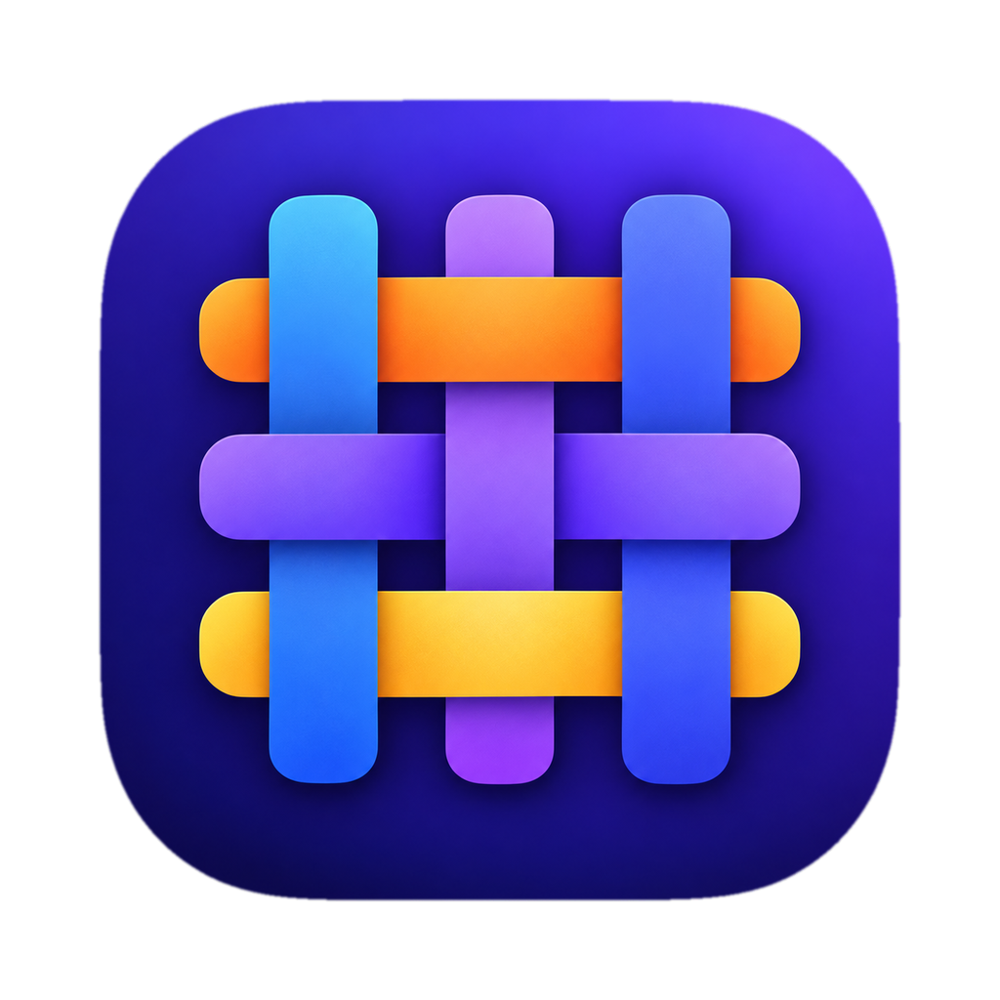</p>

# TableCraft

A desktop database IDE in the spirit of JetBrains DataGrip, for PostgreSQL, MySQL and SQLite.
Connections, a database explorer, SQL consoles with schema-aware completion, a result grid, a table
data editor, DDL and SQL generation, query history and EXPLAIN plans, in one Electron app. Databases
are reached through datasource plugins loaded at runtime.

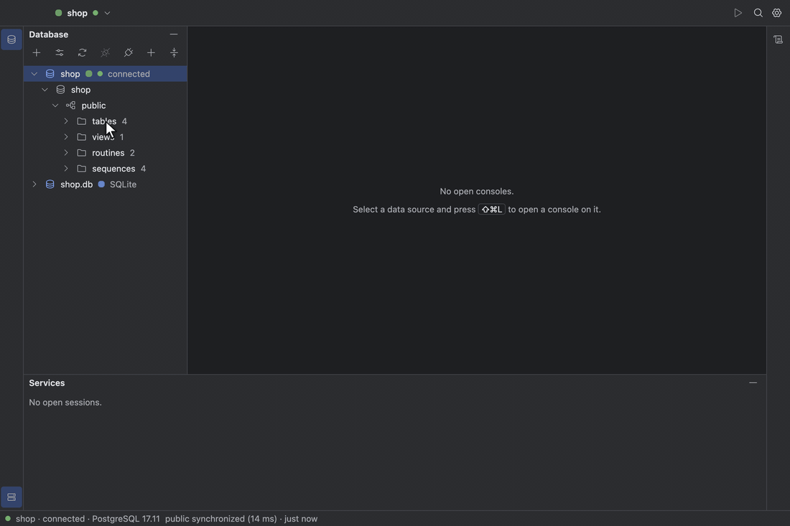

## Highlights

- [DataGrip's keymap and layout](#search-everywhere): tool windows, `⇧⇧` Search Everywhere, `⇧⌘A`
  Find Action, and the chords your hands already know.
- [Completion that knows your schema](#completion-and-navigation): tables after `FROM`, whole join
  conditions after `JOIN`, and the columns of an alias after `o.`.
- [A table editor that shows its SQL](#table-data-editor): edit cells, add and delete rows, preview
  the statements, and submit them in one transaction.
- [Explain Plan as a tree](#explain): estimated and actual rows, costs and timings; Explain Analyse
  asks before it runs a write.
- [Query history and a Services tree](#query-history-and-services): every statement you ran, per
  data source, with its outcome, row count and duration.
- [Large results stay responsive](#result-grid): rows stay in the engine process and the grid reads
  windows of them, so a million-row result does not freeze the window.
- [Themes, fonts and density](#settings-and-appearance): Dark, Light, High contrast or your own
  theme file, three font roles, and a compact layout.
- [Plugins for any database](#plugins): PostgreSQL, MySQL and SQLite are plugins, loaded the same
  way yours would be.

## Install

Installers are published on the [Releases](https://github.com/tranphucbol/table-craft/releases)
page; the first release is not out yet.

| Platform              | File                                   |
| :-------------------- | :------------------------------------- |
| macOS (Apple silicon) | `TableCraft-<version>-arm64.dmg`       |
| macOS (Intel)         | `TableCraft-<version>-x64.dmg`         |
| Windows x64           | `TableCraft-<version>-x64.exe`         |
| Linux x64             | `TableCraft-<version>-x86_64.AppImage` |

The builds are not signed with a paid certificate, so the first launch needs one extra step:

- **macOS**: see [Running the unsigned macOS app](#running-the-unsigned-macos-app) below.
- **Windows**: SmartScreen says _Windows protected your PC_; click **More info**, then **Run
  anyway**.
- **Linux**: make the AppImage executable with `chmod +x TableCraft-*.AppImage` and run it.

### Running the unsigned macOS app

The DMGs are ad-hoc signed rather than notarized, because a Developer ID belongs to whoever ships
the build and not to this repository
([decision 033](docs/decisions/033-the-packaged-app-is-dist-in-asar-with-plugins-beside-it.md)).
macOS quarantines anything a browser downloaded, and Gatekeeper refuses to open a quarantined app it
cannot verify. Depending on the macOS version it says either _“TableCraft” Not Opened. Apple could
not verify “TableCraft” is free of malware…_ or _“TableCraft” is damaged and can’t be opened_. The
app is not damaged; only the download attribute is in the way.

1. Open the DMG and drag `TableCraft.app` to `/Applications`.
2. Clear the attribute the download added:

   ```sh
   xattr -dr com.apple.quarantine /Applications/TableCraft.app
   ```

3. Open TableCraft as usual.

Nothing inside the app changes; only that attribute is removed, and only once per download.

If you would rather not use the terminal and macOS showed _Not Opened_, click **Done**, open
**System Settings → Privacy & Security**, scroll to **Security**, click **Open Anyway** next to the
message about TableCraft, and confirm with your password. That button appears only for an hour or
so after the refused launch. The _damaged_ message offers no such button; use `xattr`.

Pick the DMG that matches your Mac: `arm64` for Apple silicon, `x64` for Intel. An app you build
yourself with `bun run desktop:package` was never downloaded, so it carries no quarantine and opens
directly.

### Build from source

You need [Bun](https://bun.sh) 1.3.4 (the version in `.bun-version`) and Node 22 or later.

```sh
bun install
bun run desktop            # build and launch the app
bun run desktop:package    # an installer for this machine in packages/desktop/release/
```

## Quick start

1. Press `⌘N` (`Ctrl+N`) in the Database pane, or pick **New Data Source…** from the data source
   widget in the toolbar, and choose PostgreSQL, MySQL or SQLite.
2. Fill in the connection, click **Test Connection**, then **OK**. The data source appears in the
   Database tree.
3. Select it and press `⇧⌘L` (`Ctrl+Shift+L`) to open a console. Type a query and press `⌘↩`
   (`Ctrl+Enter`) to run the statement at the caret.
4. Select a table in the tree and press `F4` to open its data in the table editor.

## How it works

TableCraft runs three kinds of process. The main process owns windows, menus and saved settings,
and holds no database state. Each connected data source gets its own engine, an Electron utility
process that loads the plugin and runs the queries, so a slow or crashing driver takes down one data
source, not the app. The renderer is a pure view that talks to the engine over a `MessagePort`.
Result rows stay in the engine; the grid reads windows of them, and sorting, copying and exporting
happen there too. Everything a dialect knows about SQL, from splitting statements to completion and
EXPLAIN, lives in its plugin, and the built-in plugins load through the same runtime loader as user
plugins. The [specification](docs/design/specification.md) describes the whole of v1, and
[docs/decisions](docs/decisions/) records why it is built this way.

## Features

### Connections

The **Data Sources** dialog lists your data sources on the left and edits one on the right: name,
folder, comment, the plugin's connection fields, read-only mode and a colour that tints its tabs.
**Test Connection** reports the server version and round trip before you save. Each password has a
save mode: _Forever_ keeps it encrypted by the operating system's keychain, _Until restart_ keeps it
in memory, and _Never_ asks on every connect.

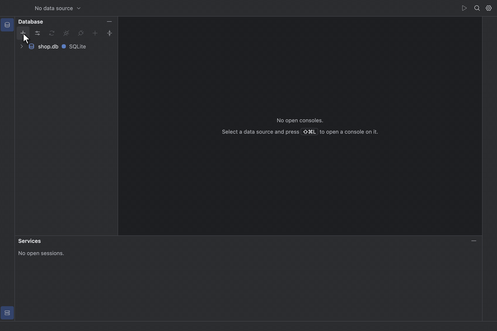

See [Datasources and secrets](docs/design/specification.md#datasources-and-secrets).

### Database explorer

The Database tool window (`⌘1`) is a lazy tree: data source, schemas, then `tables`, `views` and
their columns, keys, foreign keys and indexes. Expanding a disconnected data source connects it.
Typing in the tree starts speed search, `F1` shows Quick Documentation for the selected object, and
`⌘B` opens its DDL. **Synchronize** (`⌥⌘Y`) reloads the tree from the database.

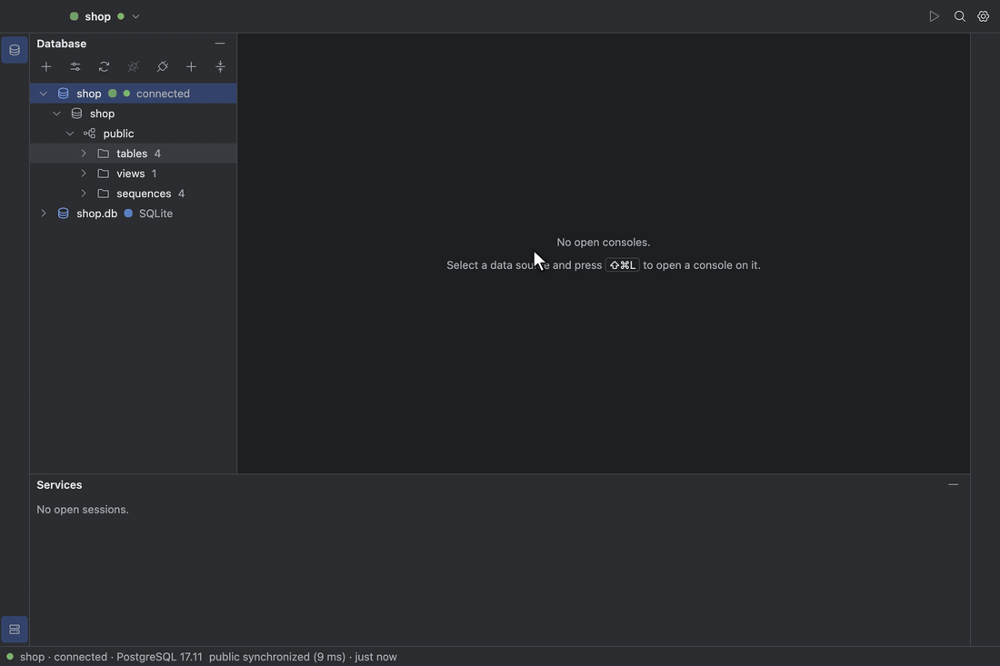

See [Database explorer](docs/design/specification.md#database-explorer).

### SQL console

`⌘↩` runs the statement at the caret, or the selection; `⇧⌘↩` runs the whole console. Each result
opens its own tab next to **Output**, which logs every statement with its row count and time.
`UPDATE` or `DELETE` without a `WHERE`, `DROP` and `TRUNCATE` are listed in a confirmation before
anything runs. Switch
**Tx: Auto** to **Tx: Manual** to work in a transaction, then **Commit** or **Rollback**. Consoles
are saved as files as you type.

**Reformat Code** (`⌥⌘L`) lays out the selection, or the whole console, and one `⌘Z` takes it
back. A statement with `:name`, `?` or (on PostgreSQL) `$1` placeholders asks for their values
before it runs; they are bound by the driver, never pasted into the SQL, and the next run starts
from them.

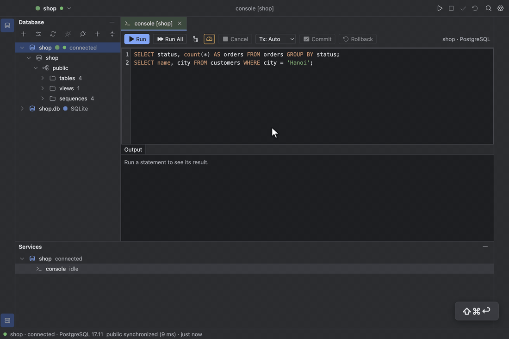

See [SQL console](docs/design/specification.md#sql-console).

### Completion and navigation

Completion runs in the engine against a cache of the catalog. After `FROM` it offers relations;
after `JOIN` it offers whole join conditions that follow foreign keys, such as
`customers c ON c.id = o.customer_id`; after `c.` it offers the columns of that alias. `⌃Space`
opens it anywhere. `⌘B` (Go to Declaration) on an alias moves the caret to where it is defined, and
on a table opens its DDL.

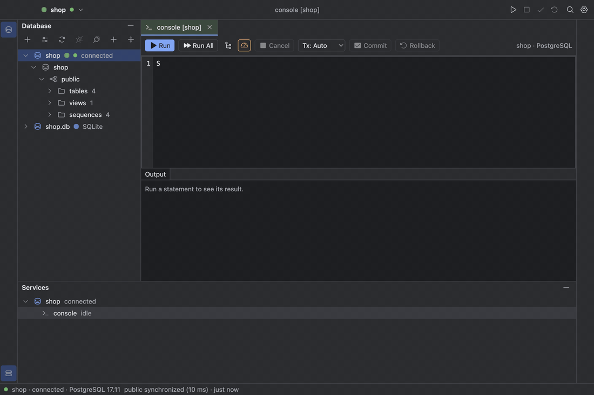

See [Completion and navigation](docs/design/specification.md#completion-and-navigation).

### Result grid

The grid shows the first page (500 rows by default) and keeps the cursor open: **Fetch Next Page**
and **Fetch All** read more. Clicking a header sorts ascending, descending, then not at all; `⌥`-click
adds a second key. `⇧↩` opens the value panel for long text and JSON. **Copy** uses the
chosen extractor: CSV, TSV, JSON, SQL Inserts or Markdown. **Export Data…**, on a result or on a
table in the Database pane, writes any of those or Excel (XLSX) in the background: it streams
straight to disk, so a multi-gigabyte export uses flat memory, shows its progress under **Exports**
in Services, and never leaves a half-written file behind when the network drops, the disk fills or
you cancel.

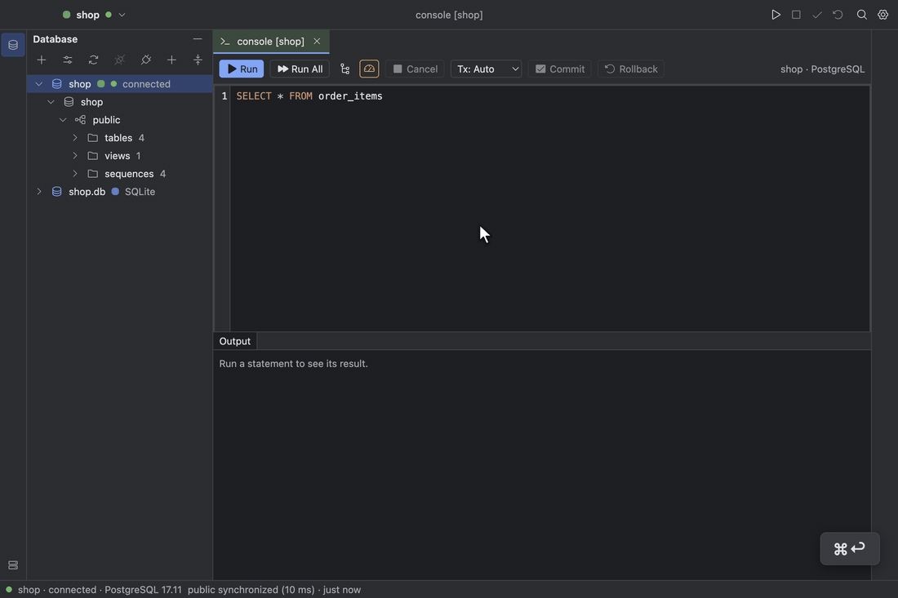

See [Result grid](docs/design/specification.md#result-grid).

### Table data editor

`F4` on a table opens its rows in a tab with a `WHERE` bar and an `ORDER BY` bar. Edit cells in
place, add rows with `⌘N` and delete them with `⌘⌫`; changes stay pending and highlighted until you
submit. **Preview Pending Changes** (`⇧⌘P`) shows the SQL, and **Submit** (`⌘↩`) runs it in one
transaction: if any statement fails or touches more than one row, everything rolls back and your
edits stay. `⌘B` on a foreign key cell opens the referenced row.

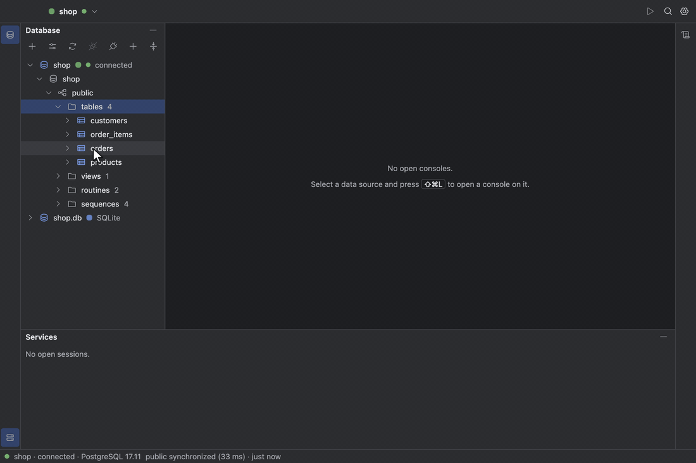

See [Table data editor](docs/design/specification.md#table-data-editor).

### DDL and SQL generation

`⌘B` on a table or view opens its definition, read from the database, in a DDL tab you can copy or
open in a console. The **SQL Generator** (`⌥⌘G`) writes `CREATE`, `DROP`, `SELECT`, `INSERT` or
`UPDATE` statements for the selected objects and opens them in a console.


See [DDL and SQL generation](docs/design/specification.md#ddl-and-sql-generation).

### Query history and Services

Every statement you run is kept per data source in a local history. **Query History…** (`⌥⌘E`)
searches it, and `↩` puts the chosen statement at the caret. The Services tool window (`⌘8`) shows
each connected data source, a session per tab, and its recent executions with outcome, rows,
duration and start time.

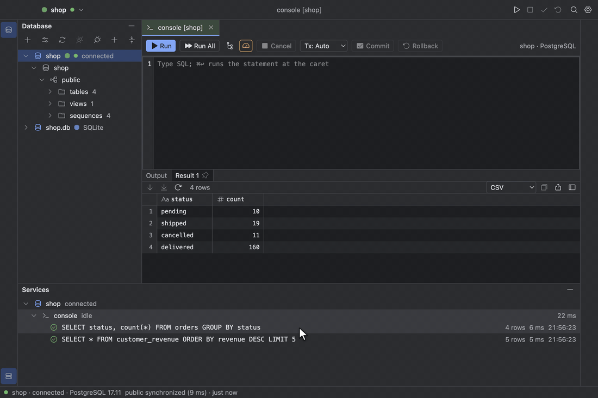

See [Query history and Services](docs/design/specification.md#query-history-and-services).

### Explain

**Explain Plan** (`⇧⌘E`) shows the plan of the statement at the caret as a tree with estimated rows
and cost; select a node to see its details. **Explain Analyse** runs the statement and adds actual
rows, time and loops; when the statement writes, it asks first. PostgreSQL and MySQL support both;
SQLite has Explain Plan only.

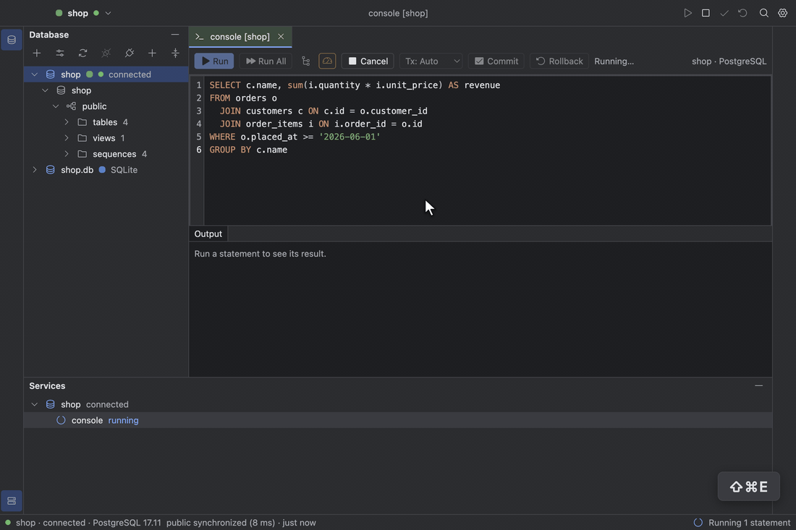

See [Explain](docs/design/specification.md#explain).

### Search Everywhere

Press `⇧⇧` to search tables and actions together, or `Tab` to the **Tables** or **Actions** tab;
`↩` on a table opens its data. **Find Action** (`⇧⌘A`) lists every command with its shortcut, so
nothing is only reachable by a chord.

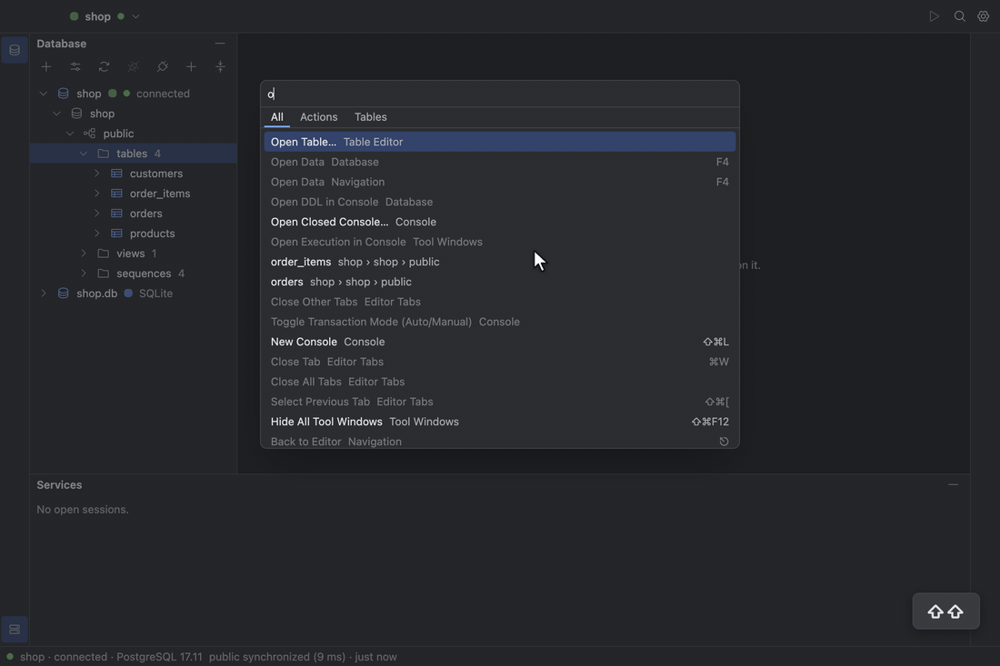

See [Shell and actions](docs/design/specification.md#shell-and-actions).

### Settings and appearance

**Settings…** (`⌘,`) has pages for Appearance, Editor, Data Editor and Advanced. Themes and density change
live; Follow system picks Dark, Light or High contrast from the operating system. `⌘=`, `⌘-` and
`⌘0` zoom the editor font.

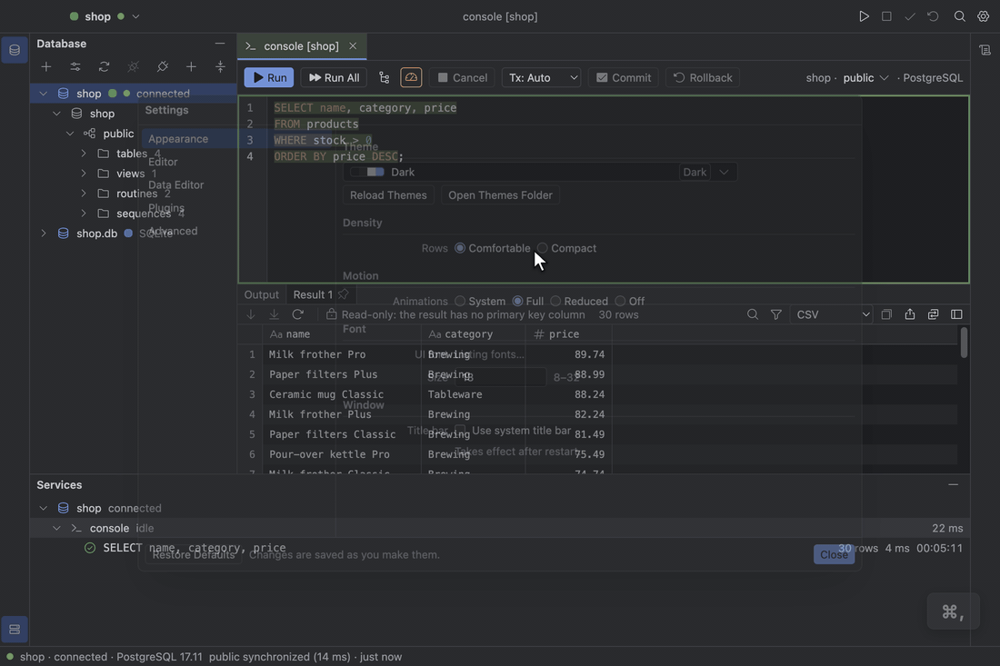

See [Settings and appearance](docs/design/specification.md#settings-and-appearance).

### App log and diagnostics

TableCraft keeps a log of what it does: launches, connections, statements by kind, row count and
duration, exports, engine restarts and errors. It records no passwords, no row values and no SQL
text. **Help → Show Log** opens the Log tool window, newest first, with filters for level, scope
and text; an error notice's **Show in Log** opens it on the records of that request. **Help →
Export Diagnostics…** saves a zip with the logs, versions, settings, data sources without
credentials and recent run metadata, for attaching to a bug report. Turn on **Debug logging** in
Settings → Advanced to record every request while reproducing a problem.

See [App log and diagnostics](docs/design/specification.md#app-log-and-diagnostics).

## Keyboard shortcuts

| Action                    | macOS   | Windows / Linux        |
| :------------------------ | :------ | :--------------------- |
| Run                       | `⌘↩`    | `Ctrl+Enter`           |
| Run All                   | `⇧⌘↩`   | `Ctrl+Shift+Enter`     |
| Explain Plan              | `⇧⌘E`   | `Ctrl+Shift+E`         |
| Commit                    | `⌥⇧⌘↩`  | `Ctrl+Alt+Shift+Enter` |
| Reformat Code             | `⌥⌘L`   | `Ctrl+Alt+L`           |
| New Console               | `⇧⌘L`   | `Ctrl+Shift+L`         |
| Close Tab                 | `⌘W`    | `Ctrl+W`               |
| Select Next Tab           | `⇧⌘]`   | `Ctrl+Shift+]`         |
| Select Previous Tab       | `⇧⌘[`   | `Ctrl+Shift+[`         |
| Database                  | `⌘1`    | `Ctrl+1`               |
| Services                  | `⌘8`    | `Ctrl+8`               |
| Hide All Tool Windows     | `⇧⌘F12` | `Ctrl+Shift+F12`       |
| Search Everywhere         | `⇧⇧`    | `Double Shift`         |
| Find Action…              | `⇧⌘A`   | `Ctrl+Shift+A`         |
| New Data Source…          | `⌘N`    | `Ctrl+N`               |
| Data Source Properties…   | `⌘;`    | `Ctrl+;`               |
| Disconnect                | `⌘F2`   | `Ctrl+F2`              |
| Synchronize               | `⌥⌘Y`   | `Ctrl+Alt+Y`           |
| Go to DDL                 | `⌘B`    | `Ctrl+B`               |
| Go to Declaration         | `⌘B`    | `Ctrl+B`               |
| Quick Documentation       | `F1`    | `F1`                   |
| Open Data                 | `F4`    | `F4`                   |
| SQL Generator…            | `⌥⌘G`   | `Ctrl+Alt+G`           |
| Query History…            | `⌥⌘E`   | `Ctrl+Alt+E`           |
| Preview Pending Changes   | `⇧⌘P`   | `Ctrl+Shift+P`         |
| Submit                    | `⌘↩`    | `Ctrl+Enter`           |
| Settings…                 | `⌘,`    | `Ctrl+,`               |
| Increase Editor Font Size | `⌘=`    | `Ctrl+=`               |
| Decrease Editor Font Size | `⌘-`    | `Ctrl+-`               |
| Reset Editor Font Size    | `⌘0`    | `Ctrl+0`               |

Find Action (`⇧⌘A`) lists every action with its shortcut; the specification's
[action table](docs/design/specification.md#shell-and-actions) has the full keymap.

## Settings

Settings live in `settings.json` in your [profile folder](#where-your-data-lives). The Settings
dialog writes it; you can also edit it by hand, and a field that is missing or out of range falls
back to its default without affecting the others.

| Field                                  | Values                                                             | Default       |
| :------------------------------------- | :----------------------------------------------------------------- | :------------ |
| `appearance.theme`                     | `system`, `dark`, `light`, `highContrast`, `user:<file stem>`      | `system`      |
| `appearance.density`                   | `comfortable`, `compact`                                           | `comfortable` |
| `appearance.systemTitleBar`            | `true`, `false`; read when the window opens                        | `false`       |
| `appearance.fonts.ui`                  | `family`: a font name, or `null` for the built-in; `sizePx`: 8–32  | `null`, 13    |
| `appearance.fonts.editor`              | `family`: a font name, or `null` for the built-in; `sizePx`: 8–32  | `null`, 13    |
| `appearance.fonts.grid`                | `family`: a font name, or `null` for the built-in; `sizePx`: 8–32  | `null`, 12    |
| `editor.format.keywordCase`            | `upper`, `lower`, `preserve`; how Reformat Code cases keywords     | `upper`       |
| `editor.format.indentWidth`            | 1–8 spaces                                                         | 2             |
| `editor.format.linesBetweenStatements` | 0–5 blank lines                                                    | 1             |
| `console.parameters`                   | `true`, `false`; ask for `:name`, `?` and `$1` values before a run | `true`        |
| `data.nullText`                        | 1–16 characters                                                    | `<null>`      |
| `data.groupDigits`                     | `true`, `false`                                                    | `false`       |
| `data.pageRows`                        | 10–10,000                                                          | 500           |
| `data.fetchAllCap`                     | 1,000–1,000,000, at least `pageRows`                               | 100,000       |
| `log.level`                            | `info`, `debug`                                                    | `info`        |
| `data.exportStallSeconds`              | 10–3,600; an export that receives nothing this long fails          | 120           |

A theme of your own is a JSON file in `themes/` in the profile folder. It names a built-in theme as
its base and overrides any of its colour tokens; it then appears as `user:<file stem>`, here
`user:solarized`:

```json
{
  "name": "Solarized Dark",
  "base": "dark",
  "colors": {
    "canvas": "#002b36",
    "panel": "#073642"
  }
}
```

**Reload Themes** in the Settings dialog picks up new or changed files.

## Plugins

A plugin is a folder with a `table-craft-plugin.json` manifest and an ES module. The built-in
plugins ship inside the app; your own go in `plugins/<id>/` in the
[profile folder](#where-your-data-lives) and load the same way. A plugin that fails to load is
listed as unavailable with the reason; the app keeps running.

The manifest declares what the plugin can do, and the UI offers only what it declares:

- `sql`: runs one statement and returns rows or a row count; the plugin also supplies the SQL
  language (splitting, classifying, completion).
- `cancel`: stops a running statement.
- `schemaTree`: lists schemas and describes tables, views, columns, keys and indexes.
- `transactions`: switches between auto-commit and manual transactions, commits and rolls back.
- `ddl`: returns the definition of a table or view.
- `explain`: returns the plan of a statement without running it.
- `explainAnalyze`: runs a statement and returns its plan with actual rows and times.

```json
{
  "id": "postgres",
  "name": "PostgreSQL",
  "version": "0.0.0",
  "apiVersion": "0.11.0",
  "entry": "index.js",
  "capabilities": ["sql", "cancel", "schemaTree", "transactions", "ddl", "explain", "explainAnalyze"],
  "highlight": "postgresql",
  "connection": {
    "fields": [
      { "key": "host", "label": "Host", "kind": "text", "default": "localhost", "required": true },
      { "key": "password", "label": "Password", "kind": "password", "secret": true }
    ]
  }
}
```

A plugin depends on `@table-craft/plugin-api` and should pass its contract suite,
`runPluginContract` from `@table-craft/plugin-api/testing`, which the built-in plugins run against
real databases. The plugin API is not stable yet: while it is 0.x, `apiVersion` must match the app's
minor version exactly. See [Plugin contract](docs/design/specification.md#plugin-contract).

## Where your data lives

Everything is stored in one profile folder:

- macOS: `~/Library/Application Support/table-craft`
- Windows: `%APPDATA%\table-craft`
- Linux: `~/.config/table-craft`

| Path               | Holds                                                                     |
| :----------------- | :------------------------------------------------------------------------ |
| `datasources.json` | Data sources and folders, without passwords                               |
| `secrets.json`     | Passwords saved _Forever_, encrypted with the operating system's keychain |
| `consoles/`        | One folder per data source with its console files                         |
| `history.sqlite`   | Query history                                                             |
| `settings.json`    | [Settings](#settings)                                                     |
| `logs/`            | The app log, `table-craft.log` and up to four older files of 5 MB each    |
| `themes/`          | Your themes                                                               |
| `plugins/`         | Your plugins                                                              |

Passwords are never written to `datasources.json` or to the log, and there is no plaintext fallback:
where the keychain cannot encrypt, _Forever_ is disabled. TableCraft sends nothing anywhere
except to the databases you connect to.

## Not in v1

- Planned for v1.1: SSH tunnels and saved query files.
- Later: ER diagrams, schema compare and migrations, data import, a plugin marketplace, Redis and
  MongoDB plugins, a CLI, AI assistance, Git integration, a debugger, notebooks, Docker and
  Kubernetes integration.

## Development

TableCraft is a Bun workspace written in TypeScript. The database suites need Docker; recording the
README GIFs also needs [ffmpeg](https://ffmpeg.org).

```sh
bun install
bun run desktop                # build and launch the app
bun run test                   # unit tests and the plugin contract against SQLite
bun run test:db                # the contract against PostgreSQL and MySQL in Docker
bun run test:smoke             # drive the built app with Playwright
bun run test:smoke:db          # the same against PostgreSQL, MySQL and SQLite
bun run test:smoke:packaged    # drive the packaged app
bun run lint                   # ESLint, including the architecture fences
bun run typecheck              # every TypeScript program
bun run format                 # Prettier
bun run desktop:package        # an installer for this machine
bun run readme:media           # re-record the GIFs in this README
```

[AGENTS.md](AGENTS.md) explains the layout and conventions,
[docs/design](docs/design/) holds the specification and design system, and
[docs/decisions](docs/decisions/) records the decisions behind them.

## License

[MIT](LICENSE)
